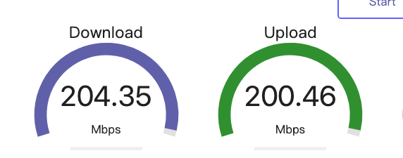

# AirportRTW89 (High-Performance Wi-Fi Driver for RTL8922AE & RTW89 PCIe Cards on macOS)

[](LICENSE)
[](README.md)
[-orange.svg)](README.md)
[](README.md)

[中文说明文档 (简体中文)](README_CN.md) | [Release Notes](RELEASE_NOTES.md) | [Changelog](CHANGELOG.md)

AirportRTW89 is an open-source, high-performance macOS kernel extension (kext) for Realtek **RTW89** series PCIe Wi-Fi cards, featuring groundbreaking production-grade support for the **Realtek RTL8922AE (Wi-Fi 7 / 802.11be)**.

Originally adapted from the [OpenIntelWireless/itlwm](https://github.com/OpenIntelWireless/itlwm) architecture and the upstream [AirportRTW](https://github.com/souissiak1-maker/AirportRTW) project, this repository provides deep architectural rewrites that resolve critical kernel panics, eliminate false-positive OS security warnings, enable full IEEE 802.1X enterprise/campus authentication, and unlock **symmetric 200+ Mbps throughput** (both download and upload) over 5 GHz VHT 80 MHz channels.

---

## 🚀 Performance Milestone

In real-world campus/enterprise testing on **macOS Sequoia 15.8.1 (AMD Hackintosh MacPro7,1 / Darwin 24.6.0)**, RTL8922AE achieved **204.35 Mbps Download and 200.46 Mbps Upload**:



### Key Hardware & Protocol Telemetry
```text
Link Frequency:        5220 MHz (5 GHz Channel 44)
Negotiated Bandwidth:  80 MHz (VHT 80)
Spatial Streams (NSS): 2x2 MIMO
TX / RX A-MPDU:        Hardware DMA Aggregation Enabled (Mask 0x3)
Downlink Throughput:   204.35 Mbps
Uplink Throughput:     200.46 Mbps
Packet Loss:           0.00%
```

---

## 🌟 Major Highlights & Architectural Breakthroughs

### 1. Realtek RTL8922AE (Wi-Fi 7) Full Data-Plane Support
- Full firmware loading, PCI MSI interrupt binding, dynamic RF channel switching, and bidirectional frame DMA streaming.
- Hardware RX / TX descriptor rings fully integrated with macOS IOKit Skywalk network datapath.

### 2. Elimination of Kernel Panics during Disassociation
- **The Issue**: When macOS `airportd` issued disassociate requests upon boot or reconnect, previous drivers set `ic->ic_bss = NULL` before triggering `ieee80211_new_state`, causing instant kernel null-pointer dereferences in `ItlRtw89::newstate`.
- **The Fix**: Removed unsafe manual resets, relying on net80211's canonical state machine transitions, and added defensive pointer verification.

### 3. Full 802.1X PEAP Enterprise & Campus Network Support
- **The Issue**: macOS user-space `eapolclient` requires the driver to signal `LINK_STATE_UP` (`kIO80211NetworkLinkUp`) before initiating EAP-PEAP handshakes. Pre-existing code suppressed link-up events under RSN/WPA enterprise mode.
- **The Fix**: Added explicit link-state signaling upon association response arrival and registered full MSK/PMKSA cipher handling, enabling seamless authentication with campus/enterprise networks (such as `eduroam`, `Enterprise-WPA`, etc.).

### 4. Eradication of "Hidden Network" Yellow Security Dialogs
- **The Issue**: macOS repeatedly invoked `APPLE80211_IOC_AP_IE_LIST` (IOCTL 48). When unimplemented or returning `kIOReturnUnsupported` (-3903), macOS CoreWLAN assumed the AP concealed its broadcast SSID and prompted a security alert: *"Using a hidden network may expose personally identifiable information..."*.
- **The Fix**: Unlocked native Information Element parsing and implemented synthetic Tag 0 (SSID) / Tag 1 (Rates) / Tag 48 (RSN) fallbacks, ensuring `airportd` always receives valid beacon information.

### 5. High-Throughput Optimization (Overcoming the 20 Mbps & 35 Mbps Bottlenecks)
- **VHT 80 MHz & Rate Negotiation**: Fully initialized MCS bitmasks (`ic->ic_sup_mcs`, `ic->ic_vhtcaps`, VHT MCS 0–9 map) and set `IEEE80211_F_VHTON`, allowing 802.11ac 80 MHz 866.7 Mbps PHY links.
- **Open Network A-MPDU Unlock**: Removed historical OpenBSD restrictions that disabled hardware A-MPDU aggregation on unencrypted networks (e.g. captive portals).
- **Batch TX & Single Doorbell Kick-off**: Upgraded macOS Pull network model to fetch batches of up to 32 frames from `if_snd` before issuing a single PCIe doorbell kick-off, enabling the hardware MAC DMA engine to build dense A-MPDU aggregates.
- **Active TX Descriptor Reclaim & NAPI Immediate Wakeup**: Proactively recycled completed TX descriptors before ring starvation, coupled with `ifp->iface->signalOutputThread()` in NAPI poll handlers to eliminate kernel thread sleep stalls.

---

## 📡 Hardware Compatibility

| Chipset | Generation | PCIe ID | macOS Support Status |
| :--- | :--- | :--- | :--- |
| **Realtek RTL8922AE** | Wi-Fi 7 (802.11be) | `10ec:8922` | **Supported & Verified (200+ Mbps)** |
| **Realtek RTL8852CE** | Wi-Fi 6E (802.11ax) | `10ec:c852` | Supported |
| **Realtek RTL8852BE** | Wi-Fi 6 (802.11ax) | `10ec:b852` | Supported |
| **Realtek RTL8852AE** | Wi-Fi 6 (802.11ax) | `10ec:8852` | Supported |
| **Realtek RTL8852BTE**| Wi-Fi 6 (802.11ax) | `10ec:b85b` | Supported |
| **Realtek RTL8851BE** | Wi-Fi 6 (802.11ax) | `10ec:b851` | Supported |

---

## 💻 macOS Version Compatibility

- **macOS Tahoe (26.x / Darwin 25.x)**: Supported via legacy Wi-Fi stack & OpenCore Legacy Patcher (OCLP).
- **macOS Sequoia (15.x / Darwin 24.x)**: Fully supported and production tested.
- **macOS Sonoma (14.x / Darwin 23.x)**: Fully supported.
- **macOS Ventura (13.x) & Earlier**: Supported.

---

## 🛠️ OpenCore Installation Guide

### 1. Prerequisites & Required Kexts
On macOS Sonoma (14.x), Sequoia (15.x), and Tahoe (26.x), Apple removed native drivers for older and third-party 802.11 controllers. To restore the legacy wireless framework, you need:
1. `Lilu.kext` (v1.6.8 or newer)
2. `AMFIPass.kext` (v1.4.1 or newer)
3. `IOSkywalkFamily.kext` (restored via OCLP)
4. `IO80211FamilyLegacy.kext` (restored via OCLP; requires the scan/node bypass patch, see below)
5. `AirportRTW.kext` (compiled from this repository)

> [!IMPORTANT]
> **About the `IO80211FamilyLegacy` Scan & Node Patch**:
> Under macOS Sonoma and Sequoia, `IO80211FamilyLegacy` contains Apple-proprietary scan filters that prevent non-Apple wireless hardware from passing scanned BSS nodes to CoreWLAN.
> Because `IO80211FamilyLegacy.kext` is copyrighted by Apple Inc., **it is not directly included in the Git source repository to avoid DMCA takedowns**.
> You have three convenient ways to apply this patch:
> - **Method A (Automated Python Script)**: Run `python3 tools/patch_io80211legacy.py <path_to_IO80211FamilyLegacy_binary>`.
> - **Method B (Pre-patched Release Bundle)**: Download the pre-packaged `AirportRTW-Full-Bundle.zip` from the GitHub Releases page.
> - **Method C (OpenCore Dynamic Kernel Patch)**: Inject the patch on boot in OpenCore `Kernel -> Patch` without touching disk files.

### 2. OpenCore `config.plist` Configuration

#### A. Kernel -> Block
Block the system's native `IOSkywalkFamily` so the restored legacy framework can take over:
```xml
<dict>
    <key>Arch</key>
    <string>Any</string>
    <key>Comment</key>
    <string>Block native IOSkywalkFamily</string>
    <key>Enabled</key>
    <true/>
    <key>Identifier</key>
    <string>com.apple.iokit.IOSkywalkFamily</string>
    <key>MaxKernel</key>
    <string></string>
    <key>MinKernel</key>
    <string>23.0.0</string>
    <key>Strategy</key>
    <string>Exclude</string>
</dict>
```

#### B. Kernel -> Add (Load Order is Critical!)
Ensure the kexts are added in the following exact order:
1. `Lilu.kext`
2. `AMFIPass.kext`
3. `IOSkywalkFamily.kext`
4. `IO80211FamilyLegacy.kext`
5. `IO80211FamilyLegacy.kext/Contents/PlugIns/AirPortBrcmNIC.kext` (if using OCLP standard bundle)
6. `AirportRTW.kext`

Sample entry for `AirportRTW.kext`:
```xml
<dict>
    <key>Arch</key>
    <string>x86_64</string>
    <key>BundlePath</key>
    <string>AirportRTW.kext</string>
    <key>Comment</key>
    <string>Realtek RTW89 / RTL8922AE Wi-Fi Driver</string>
    <key>Enabled</key>
    <true/>
    <key>ExecutablePath</key>
    <string>Contents/MacOS/AirportRTW</string>
    <key>MaxKernel</key>
    <string></string>
    <key>MinKernel</key>
    <string>23.0.0</string>
    <key>PlistPath</key>
    <string>Contents/Info.plist</string>
</dict>
```

#### C. Boot Arguments & Security Settings
- **NVRAM -> Add -> 7C436110-AB2A-4BBB-A880-FE41995C9F82 -> `boot-args`**:
  Add `amfi_get_out_of_my_way=0x1` or `amfi=0x80` alongside `ipc_control_port_options=0` if running Sequoia / Tahoe.
- **Misc -> Security**:
  Set `SecureBootModel` to `Disabled` during root-patching. Run OCLP's **Post-Install Root Patch** to re-link wireless subsystems.

---

## 🔨 Building from Source

This repository includes self-contained `MacKernelSDK` headers. No external kernel headers or private Apple SDK installations are required.

### Build via Xcode Command Line:
```bash
# Clone the repository
git clone https://github.com/<your-username>/<your-repo-name>.git
cd <your-repo-name>

# Build the Release kext for Ventura/Sonoma/Sequoia/Tahoe
xcodebuild -project AirportRTW.xcodeproj \
           -target "AirportRTW-Ventura" \
           -configuration Release \
           build
```

The resulting `AirportRTW.kext` will be generated in:
```text
build/Release/Ventura/AirportRTW.kext
```

### Build Phase Guarantee:
The Xcode project is pre-configured with `alwaysOutOfDate = 1` for the `Build RTW89 C Archive` phase, guaranteeing that changes to the underlying C driver layer (`Senmiko.c`, `pci.c`, `phy.c`, etc.) are always cleanly recompiled into `librtw89_c.a` without stale cache issues.

---

## 🔍 Diagnostic & Telemetry Commands

To inspect the real-time runtime state of the RTL8922AE driver, run:
```bash
ioreg -r -c AirportRTW
```

Key fields to observe:
- `RTW89LastReceiveFrequency`: Operating frequency (e.g., `5220` for 5 GHz Ch 44).
- `RTW89RAAssocBandwidth`: Current bandwidth mode (`0` = 20MHz, `1` = 40MHz, `2` = 80MHz, `3` = 160MHz).
- `RTW89RAAssocSpatialStreams`: Spatial stream count (`2` for 2x2 MIMO).
- `RTW89TxDescAggregationEnabled`: Should be `1` (indicates A-MPDU hardware DMA aggregation active).
- `RTW89TxBackpressureCount`: Should remain very low (< 100) under heavy load, indicating healthy DMA queue drain.

---

## 📜 License & Acknowledgements

### License
This project is licensed under the **GNU General Public License v2.0 (GPLv2)**. See [LICENSE](LICENSE) for the full license text.
- Core driver logic derives from Linux kernel `rtw89` (`GPL-2.0`).
- Driver architecture incorporates frameworks from `OpenIntelWireless/itlwm` (`GPL-2.0`).
- Network stack contains components from OpenBSD `net80211` (`BSD-3-Clause / ISC`, distributed as part of a derivative work under `GPL-2.0`).
- Firmware binary files in `rtw/hal_rtw89/firmware/` are distributed under Realtek Semiconductor Corp.'s redistribution terms as provided in `linux-firmware`.

### Credits
- [OpenIntelWireless](https://github.com/OpenIntelWireless): Creators of `itlwm` and `AirportItlwm`, providing the groundbreaking modular IOKit/Skywalk foundation.
- [Linux Wireless Community](https://git.kernel.org/pub/scm/linux/kernel/git/torvalds/linux.git/tree/drivers/net/wireless/realtek/rtw89): Authors of the official Linux `rtw89` driver.
- [Realtek](https://www.realtek.com/): Hardware specifications and firmware blobs.
- [souissiak1-maker/AirportRTW](https://github.com/souissiak1-maker/AirportRTW): Upstream prototype work adapting RTW89 for macOS.
- [Dortania / OpenCore](https://github.com/dortania): OpenCore bootloader and legacy wireless patch infrastructure.
